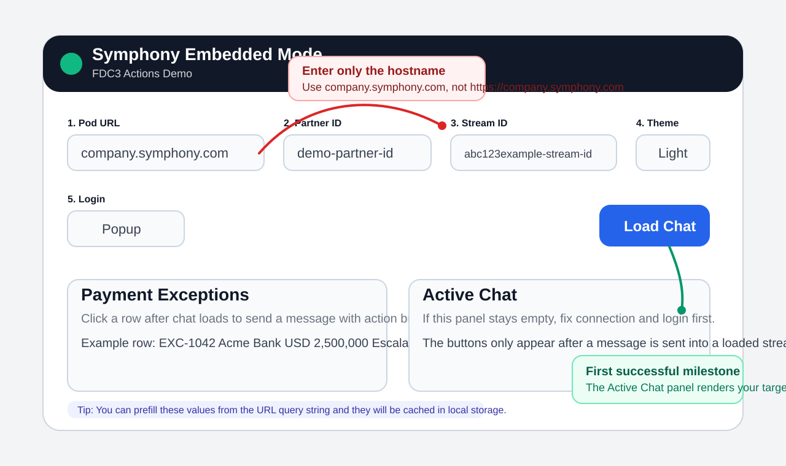

# Symphony Embedded Mode Structured Objects Demo

For native FDC3 actions that open desktop apps, use the [Native FDC3 action buttons demo](examples/native-fdc3-action-buttons/README.md).

This repository has two moving parts:

- A static host page at `https://localhost:4000` that loads Symphony Embedded Mode and sends demo messages.
- A sideloaded extension app at `https://localhost:4001` that renders the action experience inside Symphony.

If you only remember one thing, remember this:

- `4000` = host page
- `4001` = extension app
- `4001/audit` + `4001/audit-feed` = local audit write/read service owned by the extension app

## What this demo does

- Renders a Symphony Embedded Mode chat in the browser.
- Lets you click one treasury exception row or select multiple rows and send them as one structured-object batch.
- Sends a SharedMessage that includes a custom Symphony structured object.
- Uses a small sideloaded ADK extension app to render native structured-object action buttons in Symphony.
- Adds a lightweight `Treasury Exceptions` left-nav item after the renderer has loaded.

## 5-minute quick start

### 1. Start the host page on port 4000

The root app is plain HTML, CSS, and JavaScript, so it needs a local HTTPS file server.

Run this from the repository root:

```bash
mkdir -p .tmp
openssl req -x509 -newkey rsa:2048 -sha256 -days 1 -nodes \
  -subj "/CN=localhost" \
  -keyout .tmp/localhost.key \
  -out .tmp/localhost.crt

python3 -c "import http.server, ssl, socketserver, os; os.chdir(os.getcwd()); handler=http.server.SimpleHTTPRequestHandler; httpd=socketserver.TCPServer(('localhost', 4000), handler); ctx=ssl.SSLContext(ssl.PROTOCOL_TLS_SERVER); ctx.load_cert_chain('.tmp/localhost.crt', '.tmp/localhost.key'); httpd.socket=ctx.wrap_socket(httpd.socket, server_side=True); print('HTTPS server ready at https://localhost:4000', flush=True); httpd.serve_forever()"
```

Then open:

- `https://localhost:4000`

### 2. Start the extension app on port 4001

Open a second terminal:

```bash
cd extension-app
npm install
npm run dev
```

That serves:

- `https://localhost:4001/bundle.json`
- `https://localhost:4001/controller.html`
- `https://localhost:4001/audit`
- `https://localhost:4001/audit-feed`

### 3. Sideload the extension app into Symphony

Use the bundle URL from [extension-app/bundle.json](extension-app/bundle.json):

- `https://localhost:4001/bundle.json`

Open Symphony developer mode with that bundle URL encoded into the `bundle` query parameter.

### 3a. Run the lightweight regression checks

From the repository root:

```bash
npm test
```

This covers the message payload builder and the audit replay helper logic without needing a live Symphony session.

### 4. Load chat in the host page

Go back to `https://localhost:4000`, fill in the top form, and click `Load Chat`.

## What to enter in the form



| Field | What it means | Example |
| --- | --- | --- |
| Pod URL | Your Symphony pod hostname only. Do not include `https://`. | `company.symphony.com` |
| Partner ID | The Embedded Mode partner id for your app. This is not your user id. | `demo-partner-id` |
| Stream ID | The room, IM, or MIM stream id you want to open and send into. | `abc123example-stream-id` |
| Theme | The local host theme. `Light` is the simplest default. | `Light` |
| Login | How the Symphony login flow should open. `Popup` is the safest local-dev choice. | `Popup` |
| Audit Feed URL | Optional authenticated backend endpoint the host page can poll for accepted action audit events. On first load, the dashboard pre-populates this with the extension app local feed URL. | `https://api.example.com/audit/events` |

Important notes:

- The app strips `https://` automatically from `Pod URL`.
- `Partner ID` must belong to an Embedded Mode app that is valid for the same pod.
- `Stream ID` must be a real conversation the logged-in user can access.

## Fastest way to avoid typing values

The host page accepts query-string values and stores them in local storage.

Example URL:

```text
https://localhost:4000/?pod=company.symphony.com&partnerId=demo-partner-id&streamId=abc123example-stream-id&theme=light&login=popup
```

Use that once and the form will prefill. After that, the last values are restored automatically.

If you do not supply an `auditFeedUrl`, the dashboard pre-populates the field with `https://localhost:4001/audit-feed`.

That local default is intentional: the dashboard owns message sending, while the extension app owns message rendering plus action-audit ingestion and replay.

In local development, the dashboard polls `https://localhost:4001/audit-feed` as an unauthenticated cross-origin feed. Production feeds can still require authenticated requests.

## Happy path

This is the simplest possible end-to-end flow:

1. Start the host page on `https://localhost:4000`.
2. Start the extension app on `https://localhost:4001`.
3. Sideload `https://localhost:4001/bundle.json` into Symphony developer mode.
4. Open `https://localhost:4000`.
5. Enter `Pod URL`, `Partner ID`, and `Stream ID`.
6. Click `Load Chat`.
7. Confirm the `Active Chat` panel loads the target stream.
8. Click a row in `Payment Exceptions`, or tick multiple checkboxes and click `Send selected`.
9. Confirm a message appears in chat with the structured-object action card.
10. Click an action button in chat.
11. Confirm the extension controller logs `structured-object.action.audit`.
12. If an Audit Feed URL is configured, confirm the web page records `structured-object.action.audit.received` followed by `audit.state.changed`.

## Required wiring before buttons can be used

Treat this as a preflight checklist.

| Requirement | What must be true | How to verify |
| --- | --- | --- |
| Host page | The root app is reachable on HTTPS at `https://localhost:4000` | You can load the page and see the setup form |
| Extension app | The extension app is reachable at `https://localhost:4001/controller.html` | Opening the controller URL returns the blank controller page |
| Sideload bundle | Symphony can fetch `https://localhost:4001/bundle.json` | The bundle URL opens in the browser and Symphony accepts it |
| Pod access | The browser can authenticate against the same pod entered in `Pod URL` | Login succeeds and the chat panel can render |
| Partner ID | The partner id is valid for Embedded Mode on that pod | The SDK loads instead of failing immediately |
| Stream ID | The stream exists and the user can access it | The target conversation opens in `Active Chat` |
| Message wiring | The message contains a bold visible title line for composer/send compatibility, an entity placeholder with matching `data-entity-id`, and a `fdc3.symphonyEntity` whose nested data `type` matches the controller payload type | The structured-object action card appears in chat |
| App loaded | The `Treasury Exceptions` item appears in Symphony left navigation | Clicking it logs `structured-object.controller.loaded` |
| Renderer wiring | The sideloaded extension registers through `ADK.messages.registerRenderer` | Clicking a button logs `structured-object.action.audit` in the controller console |
| Audit endpoint | Local dev defaults `auditEndpointUrl` in `controller.config.json` to `https://localhost:4001/audit`; production deployments can replace it with a backend service | Button clicks are POSTed to the extension-owned local audit endpoint or the customer backend |
| Audit feed | The host page defaults to `https://localhost:4001/audit-feed` for local dev and can be pointed at a backend feed in production | `Structured Object Audit Trail` shows `structured-object.action.audit.received` followed by `audit.state.changed` |

If one row in this table is not true, fix that row first before debugging anything deeper.

## Common setup mistakes

| Symptom | Usually means | First thing to check |
| --- | --- | --- |
| Chat never loads | `Pod URL`, `Partner ID`, or auth is wrong | Confirm the browser can log into the same pod |
| Chat loads but no message is sent | `Stream ID` is wrong or the SDK is not ready yet | Confirm the `Active Chat` panel is already showing the target conversation |
| Message appears as fallback text | The extension is not loaded or the object `type` does not match the registered renderer | Check the controller iframe console for `structured-object.renderer.registered` |
| Button click logs in controller but not in host page | The host page is not reading from a backend audit feed | Configure `auditEndpointUrl` for the extension and Audit Feed URL for the host page |
| Symphony does not load the extension app | The sideload bundle URL is wrong or `localhost:4001` is not reachable | Open `https://localhost:4001/bundle.json` directly in the browser |
| Values disappear after refresh | The page was never loaded with the query string and nothing is cached yet | Load the example URL once with your own values |

## Files

- [index.html](index.html): host page shell and config form
- [styles.css](styles.css): host layout and chat container styling
- [app.js](app.js): host page bootstrap, form handling, event console, and send flow
- [demo-data.js](demo-data.js): sample payment exceptions
- [message-builder.js](message-builder.js): SharedMessage and structured-object entity construction
- [symphony-client.js](symphony-client.js): SDK loading and render flow
- [extension-app/package.json](extension-app/package.json): extension app scripts and dependencies
- [extension-app/bundle.json](extension-app/bundle.json): sideload bundle manifest
- [extension-app/controller.html](extension-app/controller.html): controller bootstrap page
- [extension-app/controller.config.json](extension-app/controller.config.json): static sideload reference values
- [extension-app/src/controller/main.ts](extension-app/src/controller/main.ts): controller entry point
- [extension-app/src/controller/startControllerApp.ts](extension-app/src/controller/startControllerApp.ts): ADK startup flow
- [extension-app/src/controller/registerStructuredObjectRenderer.ts](extension-app/src/controller/registerStructuredObjectRenderer.ts): renderer registration logic
- [extension-app/icon.svg](extension-app/icon.svg): sideload icon

## Structured object flow

The runtime flow is simple:

1. The host page loads and restores any cached values.
2. The user clicks `Load Chat`.
3. The Symphony SDK is loaded and the target stream is rendered.
4. The sideloaded extension boots through `ADK.start`.
5. The extension registers the `fdc3.symphonyEntity` wrapper with `ADK.messages.registerRenderer` and validates the nested payload `type` against `com.mistryvinay.treasury.exception`.
6. The extension adds the `Treasury Exceptions` left-nav item as a loaded indicator.
7. The user clicks one payment exception row or selects multiple rows and clicks `Send selected`.
8. The host builds a SharedMessage with a single bold visible title line and a `fdc3.symphonyEntity` payload whose `data.items` array contains the selected exception rows and whose `origin` object records the intended stream id, host page, local message id, and send time.
9. The message is sent into the active stream.
10. Symphony invokes the extension renderer, which starts directly with the exception table and native action buttons in chat.
11. Clicking a button calls the ADK renderer action callback.
12. The extension creates an audit event with action, exception, message/entity ids, origin stream metadata, duplicate status, and best-effort Symphony user identity from ADK startup.
13. The extension best-effort posts that event to the current Symphony window for local diagnostics.
14. If `auditEndpointUrl` is configured, the extension also POSTs the event to the audit service.
15. In local development, that audit service is built into the extension app at `https://localhost:4001/audit`.
16. If the host page has an Audit Feed URL, it polls the feed and renders `structured-object.action.audit.received`, then updates its in-memory state and renders `audit.state.changed`.
17. The dashboard correlates the inbound action event back to the original `hostMessageId` delivery record so the audit trail can show both the local host message id and the returned Symphony message id.

The structured object payload uses `recommendedAction` to describe the suggested operational next step for an exception. The audit event `action` field remains the source of truth for what the user actually clicked.

## Production audit contract

The production pattern is backend-mediated. The extension controller and the standalone host page are not guaranteed to share a window tree, so direct `postMessage` is diagnostic only.

Local development defaults [extension-app/controller.config.json](extension-app/controller.config.json) to:

```json
{
  "symphonyAppId": "localhost-4001",
  "objectType": "com.mistryvinay.treasury.exception",
  "auditEndpointUrl": "/audit"
}
```

That lets the extension app accept action-audit writes on `https://localhost:4001/audit` and replay them from `https://localhost:4001/audit-feed` without coupling that logic to the dashboard.

For production, configure [extension-app/controller.config.json](extension-app/controller.config.json) like this instead:

```json
{
  "symphonyAppId": "localhost-4001",
  "objectType": "com.mistryvinay.treasury.exception",
  "auditEndpointUrl": "https://api.example.com/symphony/structured-object/actions"
}
```

The extension POSTs a versioned audit envelope to that endpoint:

```json
{
  "source": "sym-em-structured-object-extension",
  "type": "structured-object.action.audit",
  "version": 1,
  "payload": {
    "auditEventId": "uuid",
    "auditKey": "hostMessageId:exceptionId:actionId",
    "status": "accepted",
    "actionId": "acknowledge-PAY-10482",
    "action": "acknowledge",
    "messageId": "treasury-PAY-10482-...",
    "entityId": "treasury-PAY-10482-...-structured-object",
    "exceptionId": "PAY-10482",
    "origin": {
      "streamId": "stream-id",
      "hostPage": "https://localhost:4000/",
      "hostMessageId": "treasury-PAY-10482-...",
      "sentAt": "2026-05-20T13:28:25.623Z"
    },
    "actor": {
      "userId": "symphony-user-id"
    }
  }
}
```

For the demo host page to show inbound action events, provide an Audit Feed URL that returns:

```json
{
  "events": [
    {
      "sequence": 1,
      "event": {
        "source": "sym-em-structured-object-extension",
        "type": "structured-object.action.audit",
        "version": 1,
        "payload": {}
      }
    }
  ],
  "latestSequence": 1
}
```

The host page calls the feed with `?after=<lastSequence>` and stores the resulting state in memory only.

If the configured Audit Feed URL responds with non-JSON content such as the dashboard HTML page itself, the host page logs `audit.feed.disabled` and stops polling until you reload with a real backend feed endpoint.

## Known limitations

- A lightweight Node test harness is included. Run `npm test` from the repository root.
- The sample depends on a live Symphony environment.
- The sample does not create streams for you.
- Audit state is kept in the web page memory for the demo and is lost on reload.
- Direct `postMessage` from the extension to the host page is diagnostic only; production action audit requires a backend endpoint.
- Duplicate action clicks are ignored by the extension audit processor, but the original chat message is not mutated or visually disabled.
