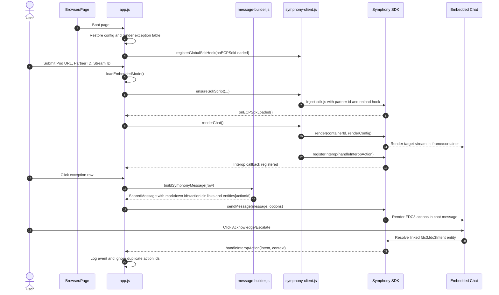

# Symphony Embedded Mode FDC3 Actions Demo

This sample shows how to:
- render a Symphony Embedded Mode chat into a host container
- send a SharedMessage with FDC3 action buttons
- register interop callbacks so button clicks are surfaced back to the host page
- log SDK lifecycle and FDC3 action events in a local console

## Files
- `index.html`: page shell and DOM containers
- `styles.css`: host layout and chat container sizing
- `app.js`: page bootstrap, event log UI, config handling, and one-shot action handling
- `demo-data.js`: sample treasury exceptions
- `message-builder.js`: SharedMessage payload and FDC3 action entity construction
- `symphony-client.js`: SDK loading, render/openStream, settings, and interop registration

## Required inputs
- Pod URL
- Partner ID
- Stream ID

The sample assumes the browser can authenticate against the target Symphony pod. Without a valid session or login handoff, the embedded iframe will render but the underlying chat bootstrap will fail.

## FDC3 action wiring
Each action button requires two matching pieces:
1. Markdown button markup using `id/<entityId>` in the message text.
2. An `entities[entityId]` object of type `fdc3.fdc3Intent`.

The host page receives the clicked intent through interop registration in `symphony-client.js`.

## How the FDC3 buttons work
The button lifecycle has three stages: initialize, register, and create.

```mermaid
flowchart TD
	A[Browser loads index.html] --> B[app.js bootstraps page]
	B --> B1[Restore query/localStorage config]
	B --> B2[Render exception table]
	B --> B3[Bind form and log handlers]
	B --> B4[Register window.onECPSdkLoaded]

	B --> C[User clicks Load Chat]
	C --> D{Pod URL, Partner ID, Stream ID present?}
	D -- No --> D1[Stop and log setup required]
	D -- Yes --> E[Inject Symphony SDK script]
	E --> F[SDK calls onECPSdkLoaded]
	F --> G[Render Embedded Mode chat]
	G --> H[Register interop callback]

	H --> I[User clicks exception row]
	I --> J[message-builder.js builds SharedMessage]
	J --> J1[Markdown contains id/actionId links]
	J --> J2[entities[actionId] are fdc3.fdc3Intent]
	J1 --> K[Send message with window.symphony.sendMessage]
	J2 --> K
	K --> L[Symphony renders FDC3 action buttons in chat]

	L --> M[User clicks Acknowledge or Escalate]
	M --> N[SDK resolves linked intent entity]
	N --> O[handleInteropAction receives intent and context]
	O --> P[Host logs event and ignores duplicate action IDs]

	Q[Browser authenticated to Symphony pod] -. required .-> G
	R[SDK exposes registerInterop] -. required for host callback .-> H
	S[id/actionId must match entities[actionId]] -. required .-> L
```

### 1. Initialize
Page startup happens in `app.js`.
- Query-string and localStorage config are restored.
- The exception table is rendered.
- The form submit handler is bound.
- A global SDK callback is registered on `window.onECPSdkLoaded`.

At this point, no FDC3 buttons exist yet. The page is only preparing the inputs and the host-side callback wiring needed for Embedded Mode.

### 2. Register
When the user clicks **Load Chat**, the app validates the required Embedded Mode inputs:
- Pod URL
- Partner ID
- Stream ID

If the Symphony SDK is not already loaded, the app injects the SDK script with:
- `render="explicit"`
- `data-onload="onECPSdkLoaded"`
- `data-partner-id="<partner id>"`

When the SDK finishes loading, the registered `window.onECPSdkLoaded` callback runs and calls the Embedded Mode render flow.

After the chat render succeeds, the app attempts to register an interop callback using `registerInterop`.

This is the key registration step for FDC3 actions. Without it:
- the action links can still render inside the Symphony message
- but the host page will not receive the clicked intent/context payload

### 3. Create
The visible FDC3 action buttons are created when a payment exception row is selected and sent to Symphony.

`message-builder.js` builds a SharedMessage payload with two matching parts:
1. Markdown text containing action links like `id/<entityId>`
2. `entities[entityId]` entries of type `fdc3.fdc3Intent`

For example:
- `§[Acknowledge](id/<actionId>)`
- `§[Escalate](id/<actionId>)`

Each entity carries:
- a title
- an intent name
- an FDC3 context payload

Symphony reads that payload and renders the action links as clickable buttons inside the chat message.

## End-to-end flow
1. The page boots and binds host-side handlers.
2. The user enters Pod URL, Partner ID, and Stream ID.
3. The SDK script loads.
4. Embedded Mode renders the target chat.
5. The host registers `registerInterop` so action clicks can be observed.
6. A user clicks an exception row in the host table.
7. The app builds a SharedMessage containing markdown action links and matching FDC3 intent entities.
8. The message is sent with `window.symphony.sendMessage(...)`.
9. Symphony renders the actions in chat.
10. When a user clicks an action in chat, the registered interop callback receives the `intent` and `context`.



## Required wiring before buttons can be used
The following must be in place before the buttons will work end to end:
- A valid host page container for Embedded Mode chat
- A working Symphony SDK load path for the target pod
- A valid Partner ID
- A valid Stream ID
- Browser access/authentication to the target Symphony pod
- A SharedMessage payload where the markdown `id/<entityId>` targets exactly match `entities[entityId]`
- SDK support for `registerInterop` if the host page needs to observe button clicks

If the markdown/entity ids do not match, the action will not behave correctly.

If chat renders but `registerInterop` is unavailable, the buttons may still appear in Symphony, but the host page will not log the callback.

## Button semantics
This sample treats action buttons as one-shot from the host perspective.
- The first click is logged and processed.
- Repeated clicks with the same action id are ignored by the host.

Note: the existing message inside Symphony is not mutated after click. If you need the button to become visually disabled in chat, that typically requires a message update or replacement capability outside the scope of this sample.

## Embedded Mode Configuration
The sample requests a compact profile through SDK settings:
- `showTitle: false`
- `showMembers: false`
- `showInfo: false`
- `symphonyLogo: false`
- `sound: false`

Some visible iframe chrome may still depend on the target pod, auth state, and SDK plan.

## Known limitations
- No automated tests are included.
- The sample depends on a live Symphony environment.
- Chat-action state is enforced in the host page, not by mutating the original chat message.
