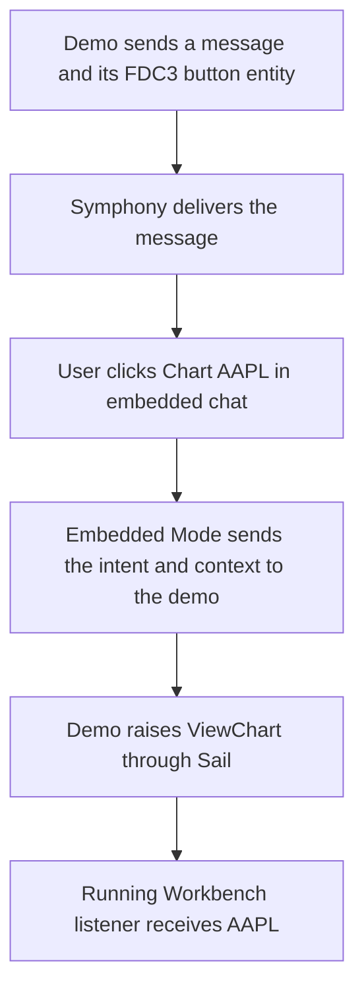

# Symphony chat action buttons with FDC3

This demo sends Symphony chat messages with FDC3 action buttons through the Embedded Mode SDK. Live UAT verified message delivery, button rendering, and routing **Chart AAPL** through FINOS Sail to a running Workbench listener.

Use this demo as a direct SDK control when a button appears in the send preview and the delivered message shows raw text such as `§[View Trade](id/trade)`.

Use branch `demo/native-fdc3-action-buttons`. The demo runs from the static HTTPS host and uses Symphony’s built-in FDC3 support. [Symphony desktop interop configuration](https://docs.developers.symphony.com/embedded-modules/desktop-interoperability/configuration-guide)

## What the demo verifies

| Stage | Evidence |
| --- | --- |
| Send through the Embedded Mode SDK | Live UAT sends returned message IDs for the chart and trade messages. The demo calls `window.symphony.sendMessage` directly, so it provides a control for comparing a wrapper integration. |
| Render and click delivered buttons in Embedded Mode | Live UAT showed the delivered buttons and registered clicks for **Chart AAPL**, **View Trade**, and **Launch Blotter**. |
| Render delivered buttons in a separate Symphony session | The same UAT messages showed plain-text labels in regular Chrome and all three buttons in the Symphony web app opened inside an FDC3 container. |
| Handle desktop agent availability | Browser tests exercised the demo’s `raiseIntent` call with a simulated agent. The UAT test in regular Chrome reported **Received · no desktop agent**. |
| Deliver a live UAT click through FINOS Sail | With the Embedded Mode demo and FINOS Workbench connected to the local Sail agent, **Chart AAPL** routed to `fdc3-workbench`. Workbench received `ViewChart` with `type: fdc3.instrument` and `id.ticker: AAPL`. |
| Start a receiving app on demand | Pending live verification with a receiver that registers its listener on startup. The UAT Workbench listener was already running. |

## Run in a browser

1. From this branch, follow the [HTTPS host step](../../STRUCTURED-OBJECTS.md#1-start-the-host-page-on-port-4000) and open the [native FDC3 demo](https://localhost:4000/examples/native-fdc3-action-buttons/).
2. Enter the test pod hostname and a **Stream ID** you can access. Leave **Partner ID** blank when the UAT pod allows it. Otherwise, supply the ID for your Embedded Mode plan and use an authorized host origin. Click **Load chat** and sign in. The demo automatically registers for button clicks on plans that support the interop API. [Partner ID configuration](https://docs.developers.symphony.com/embedded-modules/embedded-mode/pricing-tiers#partner-id) · [Embedded Mode interop notifications](https://docs.developers.symphony.com/embedded-modules/embedded-mode/notifications#get-notified-of-interop-actions)
3. Click **Send chart check** and confirm the send in Symphony. Find the message in the chat history and look for **Chart AAPL** below the cashtag. Click the delivered button and look for `ViewChart`, `fdc3.instrument`, and `AAPL` in **FDC3 events**.
4. Click **Send trade actions** and repeat for the two custom actions. Expand **SDK diagnostics** to see the request payloads, message IDs, callback events, and routing errors.

| Chat button | Intent | Context type | Identifier |
| --- | --- | --- | --- |
| Chart AAPL | `ViewChart` | `fdc3.instrument` | `ticker: AAPL` |
| View Trade | `com.example.ViewTrade` | `com.example.trade` | `tradeId: DEMO-TRADE-001` |
| Launch Blotter | `com.example.LaunchBlotter` | `com.example.blotter` | `blotterId: DEMO-BLOTTER-001` |

**View Trade** and **Launch Blotter** are example contracts for testing custom buttons. To route them to real apps, agree on the intent names, context types, and identifiers with the receiver owners, then update [the demo definitions](messages.js) and the receivers’ App Directory entries and handlers. [FDC3 custom intent naming and discovery](https://fdc3.finos.org/docs/2.0/intents/spec#namespaces)

## How it works



[The message builder](messages.js) creates a `SharedMessage`. Its Markdown contains a reference such as `§[Chart AAPL](id/chart)`. The `chart` key in `entities` defines the intent and context. [The demo page](demo.js) sends this directly to the selected stream in Blast mode with Symphony’s default confirmation dialog. [SDK send contract](https://docs.developers.symphony.com/embedded-modules/embedded-mode/send-a-message)

```js
await window.symphony.sendMessage({
  text: { "text/markdown": "**FDC3 connector check**\n\n$AAPL\n\n§[Chart AAPL](id/chart)" },
  entities: {
    chart: {
      type: "fdc3.fdc3Intent",
      data: {
        title: "Chart AAPL",
        intent: "ViewChart",
        context: { type: "fdc3.instrument", id: { ticker: "AAPL" } }
      }
    }
  }
}, { mode: "blast", streamIds: [streamId] });
```

After chat loads, the demo calls `registerInterop`. A button click in the embedded chat calls back into the host page with an intent and context. The demo adds a row to **FDC3 events** and, for the demo actions listed above, calls `window.fdc3.raiseIntent(intent, context)` when a desktop agent is available. **Routed to …** shows that the agent resolved the intent to an app. Check the receiving app for the actual action and context. [Embedded Mode interop notifications](https://docs.developers.symphony.com/embedded-modules/embedded-mode/notifications#get-notified-of-interop-actions) · [FDC3 intent resolution](https://fdc3.finos.org/docs/2.0/api/ref/DesktopAgent#raiseintent)

## Verify intent delivery with FINOS Sail and Workbench

The standalone Symphony web client displayed plain-text labels when loaded directly in Sail. The verified route used the Embedded Mode demo as the Sail app. The live test used a local adapter as the demo page’s module entry point. Bundle an entry point like this with `@finos/fdc3` to connect the demo to Sail before it loads. [Add an app to Sail](https://fdc3-sail.finos.org/docs/add-your-app/)

```js
import { getAgent } from "@finos/fdc3";

window.fdc3 = await getAgent();
await import("./demo.js");
```

1. Add the adapted Embedded Mode demo and FINOS FDC3 Workbench to Sail’s App Directory. Use `fdc3-workbench` as the Workbench app ID and declare `ViewChart` with `fdc3.instrument` under `interop.intents.listensFor`. [Run Sail locally](https://fdc3-sail.finos.org/docs/run-sail/) · [FINOS FDC3 Workbench](https://fdc3.finos.org/toolbox/fdc3-workbench/)
2. Open Workbench in Sail and add a `ViewChart` listener under **Intents**. Keep Workbench running.
3. In the Embedded Mode demo, click **Chart AAPL** in the delivered message. Check **FDC3 events** for **Routed to fdc3-workbench**. In Workbench, confirm that **Last received context** shows `type: fdc3.instrument` and `id.ticker: AAPL`.

## Verify launch on demand

1. Register the receiving app’s launchable URL in the desktop agent’s App Directory. Advertise the exact intent and context type the button carries, such as `ViewChart` with `fdc3.instrument`. [App Directory configuration](https://fdc3-sail.finos.org/docs/add-your-app/#app-directory-entry)
2. Have the receiving app connect to the agent and call `addIntentListener` at startup. The handler should use the incoming context, such as `id.ticker`, to load the requested view. [FDC3 intent handling](https://fdc3.finos.org/docs/2.0/intents/spec#intents-standard-compliance)
3. Start with the receiving app closed and click the button in the delivered message. Verify that a new app instance opens and loads the expected context. Repeat for the sender’s and recipient’s viewing environments if both are part of the integration.

## Diagnose preview-only buttons

| Observation | What to check |
| --- | --- |
| The delivered message shows a plain label such as `Chart AAPL` | Open the same message in both sender and recipient sessions. Check whether each viewing session has interop available. In the demo, check the status above **FDC3 events** and look for registration errors in **SDK diagnostics**. In a native connector session, hover over the actual `$AAPL` cashtag and look for **View Instrument**. `window.fdc3` on the host page only demonstrates agent access for that page. [Connector troubleshooting](https://docs.developers.symphony.com/embedded-modules/desktop-interoperability/configuration-guide/troubleshooting) |
| The direct SDK send works, but the wrapper shows raw `§[...]` markup | Compare the exact Markdown and `entities` passed into the SDK. Check that each reference has a matching key and that the opening parenthesis in `§[View Trade](id/trade)` has no literal backslash before it. If the wrapper supplies a Focus mode `container`, verify it targets the rendered container. If the SDK rejects the container, retry the control with the optional override omitted. |
| The direct SDK send also shows raw markup in an interop-enabled session | Use an authorized message read or message event to inspect the delivered presentation and entity data. An absent action entity points to the send or conversion path. If the entity is stored, check rendering and interop in the viewing session. A `StartChat` or bot send can provide a separate control. [Read structured objects](https://docs.developers.symphony.com/bots/messages/overview-of-messageml/entities/structured-objects#reading-objects) · [Bot action buttons](https://docs.developers.symphony.com/bots/messages/overview-of-messageml/entities/standard-entities#fdc3-action-buttons) |
| The SDK returns `messages: []` | The response contains no message ID. Check the conversation for delivery and obtain the ID from the delivered message or an authorized event for comparison. [SDK response contract](https://docs.developers.symphony.com/embedded-modules/embedded-mode/send-a-message#returned-promise) |
| A delivered button is clickable, but no app opens | Check whether the click reached the host, the desktop agent is available on the route being tested, and a receiver advertises the exact intent and context type. Use `ViewChart` with `fdc3.instrument` for the chart control. [FDC3 ViewChart contract](https://fdc3.finos.org/docs/2.0/intents/ref/ViewChart) |

Use the entity shape for the API you are calling. Embedded Mode `sendMessage` uses `fdc3.fdc3Intent` with nested `data`. The FDC3 `StartChat` example uses `fdc3.action` with `action: "raiseIntent"`. [SDK SharedMessage](https://docs.developers.symphony.com/embedded-modules/embedded-mode/send-a-message) · [StartChat message format](https://docs.developers.symphony.com/embedded-modules/desktop-interoperability/fdc3-intents/message-format#fdc3-action-buttons)

Run `npm test` from the repository root to check the payload builders and which actions the demo can forward.
